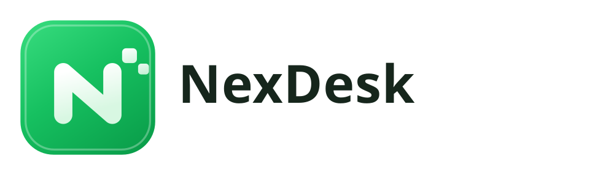

<p align="center">
  
</p>

# NexDesk

NexDesk is a free remote desktop application for Windows and Android with a
Persian-first interface. It is a fork of [RustDesk](https://github.com/rustdesk/rustdesk),
which provides the remote desktop engine; NexDesk is the product built on top of
it — branding, Persian localisation, an installer, an update feed and a
different set of defaults.

## Download

Releases are published at
<https://github.com/vahidkar20/deskyar/releases>. The product page is
<https://nexdesk.ir>.

| Platform | File | Notes |
|---|---|---|
| Windows | `NexDesk-<version>-x64.msi` | **Recommended.** A normal installer; appears in Apps & features and uninstalls cleanly. |
| Windows | `NexDesk-<version>-x86_64.exe` | Portable. Unpacks to `%LOCALAPPDATA%\nexdesk` and runs without installing. |
| Android | `NexDesk-<version>-android-universal.apk` | Universal APK, arm64 / arm / x64. |

Each release ships `SHA256SUMS.txt`. Verify a download before running it:

```powershell
Get-FileHash .\NexDesk-1.5.11-x64.msi -Algorithm SHA256
```

## Code signing policy

**NexDesk releases are not code signed yet.** There is no Authenticode
certificate behind the binaries at this time.

What that means in practice:

- Windows shows **Unknown publisher** in the UAC prompt.
- SmartScreen may show "Windows protected your PC" on first run. Choose *More
  info* → *Run anyway* only if the SHA-256 matches the release notes.
- Some antivirus engines flag the build. That is a false positive; see
  [docs/false-positives.md](docs/false-positives.md) for what has been reported
  and how to check a hash before trusting a detection.
- Browsers may warn that the download is uncommon. This is reputation, not a
  detection: a new file on a new domain has no history.

Signing is planned through the [SignPath Foundation](https://signpath.org) free
programme for open source projects. Once that is in place this section will say
so, and the publisher shown will be *SignPath Foundation*.

## Cost, and how it is funded

NexDesk is free. Development is funded by a single advertising slot on the home
screen and a banner in the mobile app.

The ad request is deliberately minimal: a plain `GET https://ad.yar.one/`
carrying one cache-busting timestamp and nothing else — no device identifier, no
install identifier, no version, no locale, no telemetry. See
[PRIVACY.md](PRIVACY.md).

## Repository layout

| Path | Contents |
|---|---|
| `src/` | Rust core: server, client, platform code |
| `flutter/` | Flutter UI (desktop and mobile) |
| `libs/portable/` | Single-file portable packer |
| `libs/privacy-host/` | Overlay process used by privacy mode |
| `res/msi/` | WiX installer project |
| `docs/` | Operator and contributor documentation |

## Building

Build instructions are in [docs/CONTRIBUTING.md](docs/CONTRIBUTING.md). The
Windows release build is
`.github/workflows/nexdesk-windows.yml`; it produces the MSI and the portable
exe from one payload, so the two never drift apart.

## Licence

NexDesk is licensed under the GNU Affero General Public License v3.0. See
[LICENCE](LICENCE) for the full text and [NOTICE](NOTICE) for attribution.

NexDesk is a derivative work of RustDesk, Copyright (C) RustDesk and
contributors, also AGPL-3.0. Changes made for NexDesk are documented in this
repository's commit history.

## Disclaimer

Remote desktop software can be used to help someone or to intrude on them. The
NexDesk maintainers do not condone unauthorised access to anyone's computer.
Sessions require the remote machine to accept a connection, and the application
shows a visible indicator while a session is active. Do not remove or hide that
indicator.
